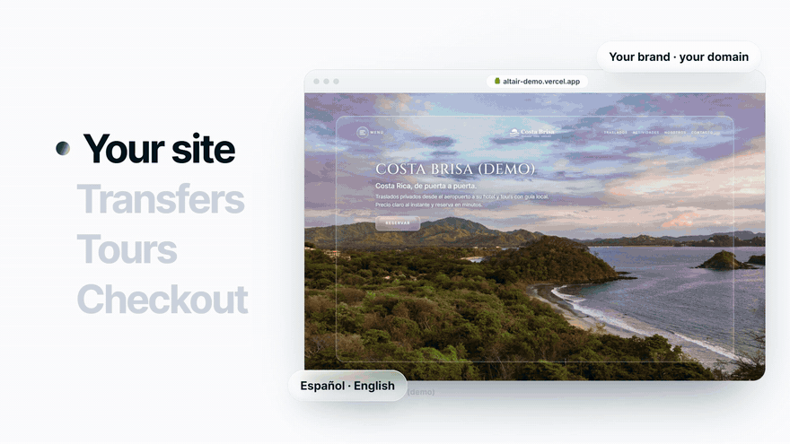
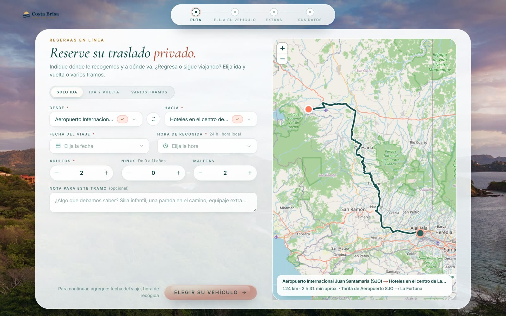
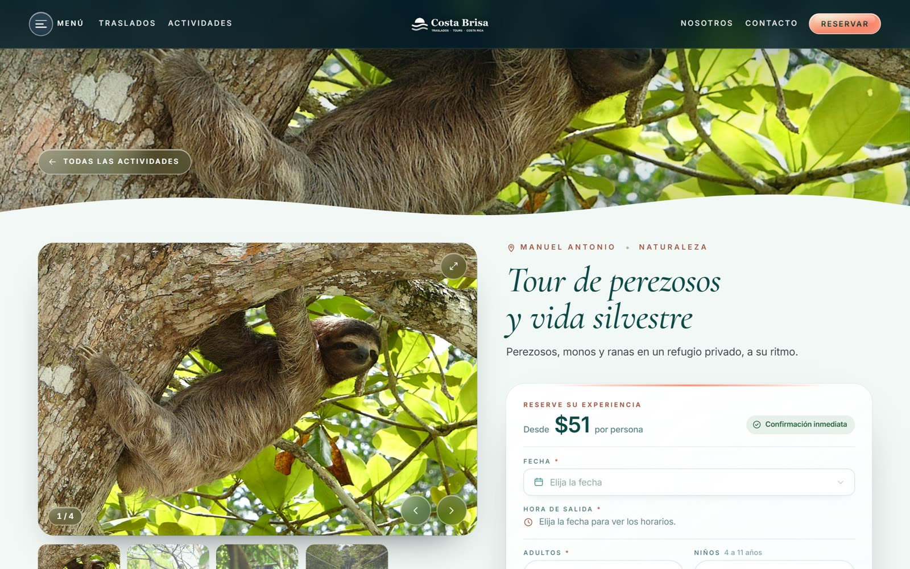
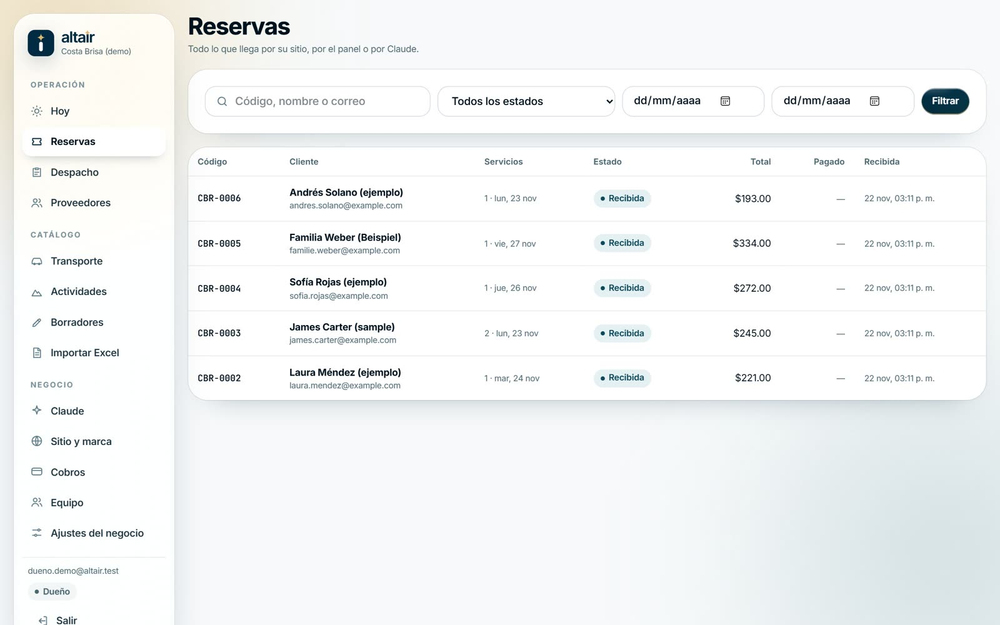
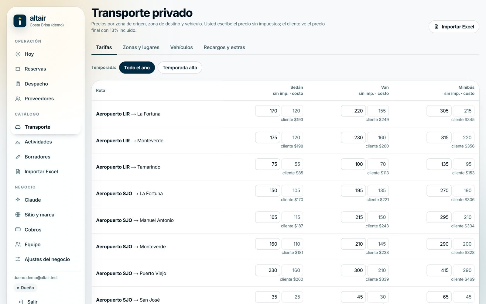

  
  
  

  Altair gives every private-transfer and tour company <b>its own booking system</b>: a booking site with its brand, 
  two pricing engines, a panel for the team and a secure connector to run the business from <b>the owner's own Claude</b>.

  Altair le da a cada empresa de traslados privados y tours su propio sistema de reservas: un sitio con su marca, 
  dos motores de precios, un panel para el equipo y un conector seguro para operar el negocio desde su propio Claude.

> [!TIP]
> **Try the idea with your own Claude in one minute:** [Altair Lite](https://altair-lite.vercel.app) is an open (MIT) demo
> of a small tourism business you run from Claude, with a live panel and sample data
> ([code](https://github.com/altairbystarknot/altair-lite)).

<b>Experimental product</b> built for the Dojo AI Hackathon 2026 · <a href="#an-experimental-product">what that means</a> · custom software for real operations at <a href="https://www.starknot.co/en/contacto">starknot.co</a>

## See it in action

The demo business <b>Costa Brisa (demo)</b> runs on real Altair with <b>sample data</b>. Try it yourself at <a href="https://altair-demo.vercel.app">altair-demo.vercel.app</a>, or <a href="https://youtu.be/c6Wl3vk9zDI">watch the 2-minute demo on YouTube</a>.

## What's inside

<table>
  <tr>
    <td width="50%"> <b>Transfers.</b> Search any airport, hotel or address; the map draws the road route and the price is exact for the vehicle and season.</td>
    <td width="50%"> <b>Tours.</b> Every activity has its own page, with real times, real seats and hotel pickup.</td>
  </tr>
  <tr>
    <td width="50%"> <b>Panel.</b> Bookings, dispatch for drivers and suppliers, rates, activities, payments and team roles.</td>
    <td width="50%"> <b>Rates.</b> By route, vehicle and season, loaded from Excel or drafted by Claude, always published by a person.</td>
  </tr>
</table>

## Run it from your own Claude

The owner adds one connector to **their own Claude** (Settings → Connectors → `https://<their-domain>/mcp`) and signs in with their Altair account. From then on Claude can look up bookings, quote transfers, assign services, draft messages and propose catalog changes.

- **Remote MCP server with OAuth 2.1**: discovery, dynamic registration, PKCE, rotating refresh tokens.
- **Checked on every call**: the token, its scope and the person's *current* role are verified on every call, and every call is logged.
- **Drafts, never money**: catalog changes arrive as drafts a person publishes. Claude never charges, refunds or moves money.
- **No AI bill inside Altair**: Altair never calls an AI model and never stores Claude credentials. The owner brings the Claude they already use.

## Secure by design

- **One dedicated instance per business**: its own database, site and domain. Isolation is physical: no business can ever read another business's data.
- **A locked-down database**: every table is protected, and every staff action requires two-step sign-in and the person's current role.
- **Visitors never write data directly**, and **the server recalculates every price**: the browser's figure is display only.
- **272 automated access checks** prove who can and cannot do what.

The security design, the database and the pricing engines live in Starknot's private core.

## How a business starts

| Step | |
|---|---|
| **1 · Request** | The business asks on [altair-hub.vercel.app](https://altair-hub.vercel.app/es/solicitar). |
| **2 · Approval** | Starknot reviews it and issues a one-time claim link. |
| **3 · Guided setup** | Brand, languages, rates (Excel or Claude), tours and payments, step by step. |
| **4 · Live** | The site opens to the public and starts taking bookings. |

Everything that differs between businesses is **data, not code**: languages, currency, taxes, brand, theme and booking engines.

## Try it

| | |
|---|---|
| Altair (product site, request form) | https://altair-hub.vercel.app |
| Demo business "Costa Brisa (demo)", sample data | https://altair-demo.vercel.app |
| Demo panel | https://altair-demo.vercel.app/login (judge access is in the hackathon submission) |
| Claude connector | `https://altair-demo.vercel.app/mcp` |
| Altair Lite (open demo, connect your Claude, no sign-in) | https://altair-lite.vercel.app · [code](https://github.com/altairbystarknot/altair-lite) |

Hackathon notes (state before the event and what was built during it): [HACKATHON.md](HACKATHON.md).

## Stack

Next.js 16 · React 19 · TypeScript · Tailwind CSS v4 · Supabase (Postgres, Auth with TOTP, Storage) · Vercel · Model Context Protocol · OAuth 2.1 · OpenStreetMap (Photon, OSRM) · Zod · Vitest · three.js / React Three Fiber · GSAP · Lenis

## In this repository

| Path | What it is |
|---|---|
| `apps/web/` | One business's instance: public site, sign-in, panel, public API, Claude connector (`/mcp`) and OAuth |
| `apps/hub/` | Altair's own site: product pages, sign-up request and Starknot's approval console |
| `packages/config/` | Contracts: business settings, site, catalog drafts, sample data |
| `packages/ui/` | Altair design system (CSS and components) |
| `tooling/` | Static checks and development helpers |
| `docs/COMO-FUNCIONA.md` | How Altair works, in plain words (Spanish) |
| `core/` | **Not included**: Starknot's private core (pricing and booking engines, money rules, database, security design, architecture notes and tests) |

## An experimental product

> [!NOTE]
> **Altair is an experimental product.** It was built in three days for the Dojo AI Hackathon 2026: use it to understand the idea and try it, but do not expect the results of a production system from it.

Altair is **inspired by the logic, and backed by the team, behind a large-scale luxury travel platform** that Starknot built for a real operator in Costa Rica. It is **not** that platform: it is a far narrower, experimental version of that know-how, and it does not have its size or its scalability. Its user experience, design, panel features and engines are not that platform's either, which is a polished product in production: Altair was built in the three days of the hackathon, as well as possible, to show the idea.

For a serious operation or an established company, Starknot builds **custom software, quoted separately**, with the size, security and scalability the business needs.

  

Free · by video call · <a href="https://www.starknot.co/es/contacto">en español</a> · <a href="https://www.starknot.co/en/contacto">in English</a>

> [!IMPORTANT]
> **Proprietary software, published for evaluation only** (see [LICENSE](LICENSE)). The private core is available only under a commercial agreement with [Starknot](https://www.starknot.co/en). Without it this repository does not build; use the live demo to try Altair.

  Built with <b>Claude Code</b> during the Dojo AI Hackathon 2026 · © 2026 <a href="https://www.starknot.co/en">Starknot</a> · Costa Rica

